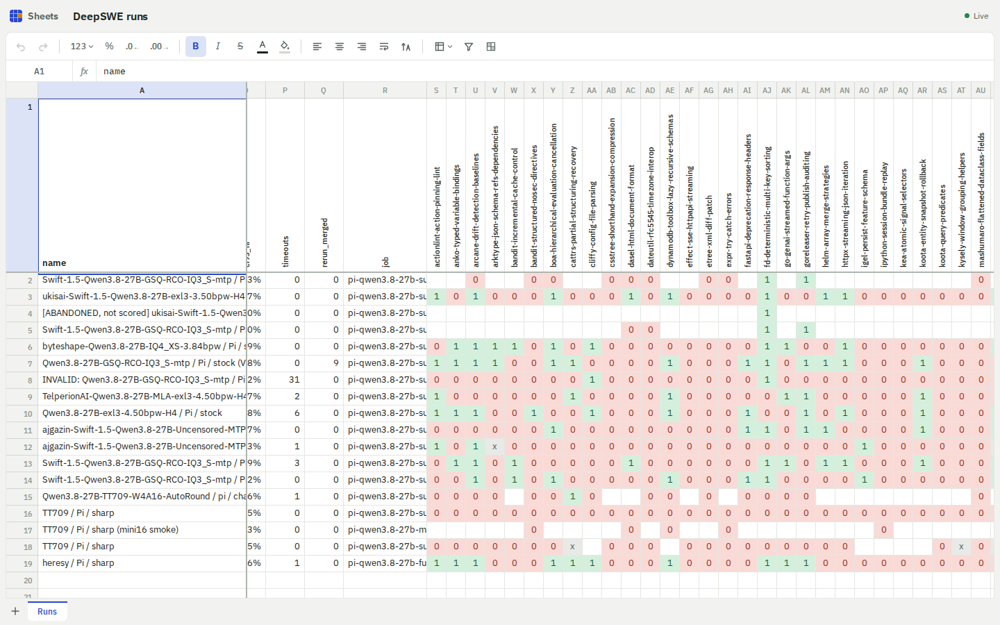
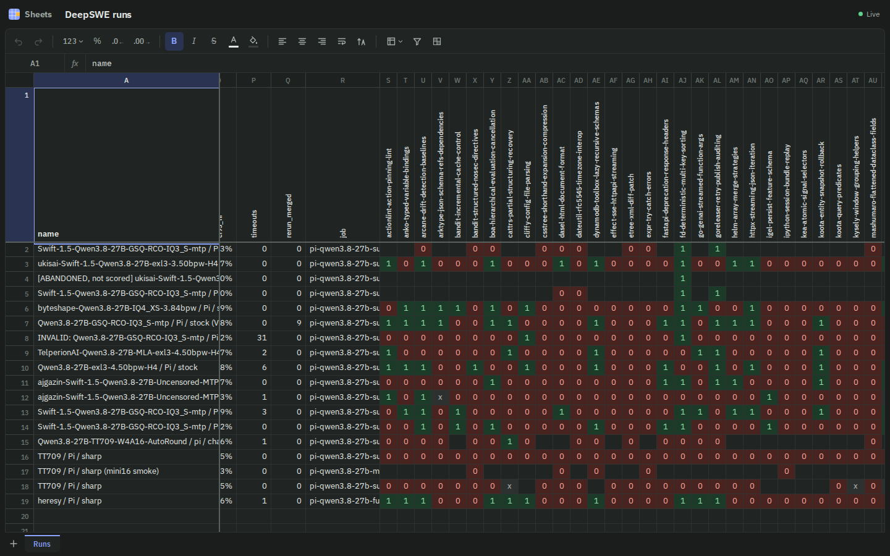
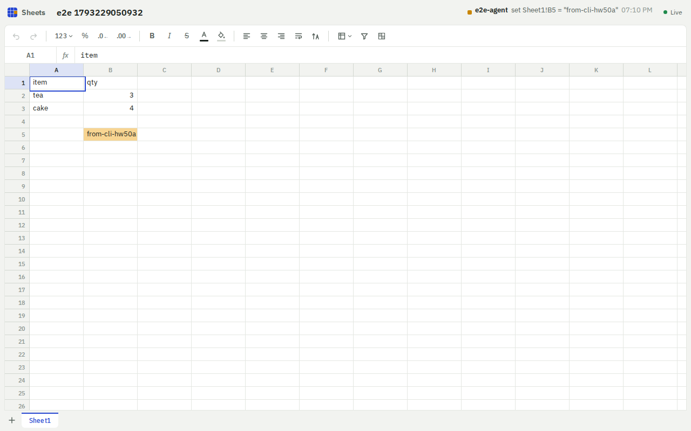
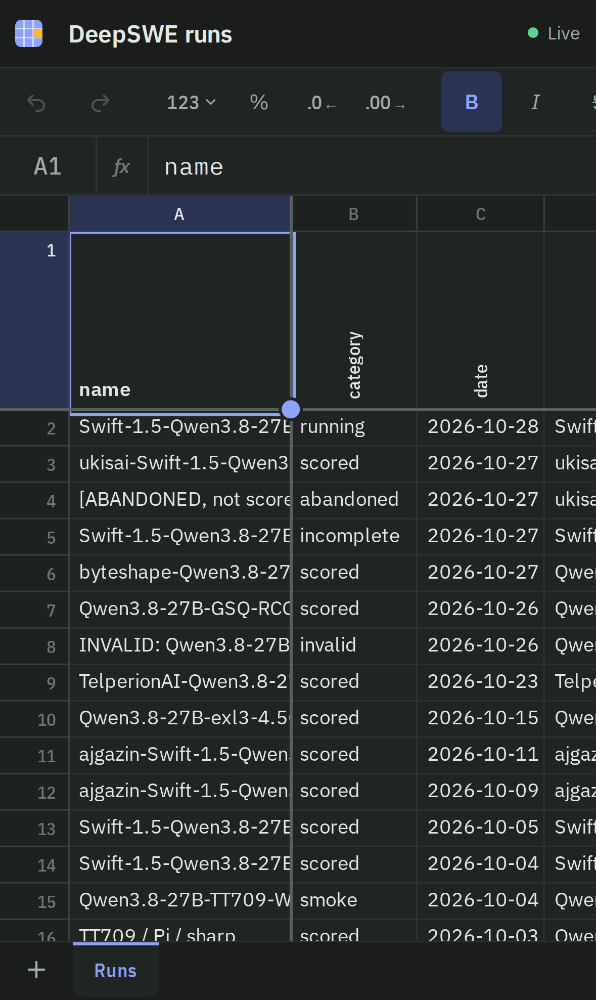
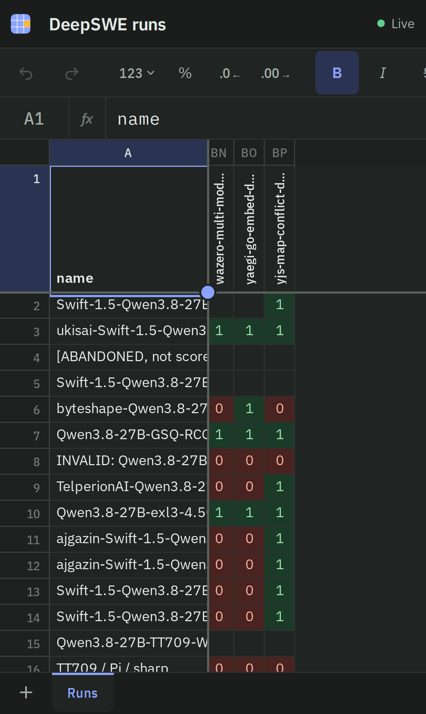

# Sheets

A small, self-hosted spreadsheet for a person and their AI agents working on the same data at the same time. An agent edits a cell from the terminal; the change appears in your open tab within a second, briefly highlighted, with the agent's name in the activity line. Your edits are readable by agents the moment you press Enter.



<table><tr>
<td></td>
<td></td>
</tr></table>

<p> </p>

## What it does

- Workbooks with multiple tabs; a virtualized grid that stays smooth with 50k+ cells.
- Click, shift-click and drag selection; type to edit; Enter, Tab, arrows, Esc, F2, Delete; Ctrl+arrow jumps; Ctrl+D / Ctrl+R fill.
- Copy and paste as TSV, compatible with Google Sheets and Excel. Pasted formulas shift their relative references.
- Undo and redo of your own edits, even while others are editing.
- Formulas with A1 references, ranges and cross-sheet references: arithmetic, comparison, `&`, `SUM AVERAGE COUNT COUNTA COUNTBLANK MIN MAX MEDIAN PRODUCT IF IFERROR AND OR NOT ROUND ROUNDUP ROUNDDOWN ABS COUNTIF SUMIF AVERAGEIF LEN UPPER LOWER TRIM CONCAT ISBLANK ISNUMBER ISERROR`. Recalculation follows dependencies; errors are `#REF!`, `#DIV/0!`, `#NAME?`, `#VALUE!`, `#CIRC!` (circular reference).
- Insert and delete rows and columns (formulas everywhere are rewritten), resize, hide and unhide, freeze rows and columns.
- Sort and filter as a shared, persisted view that never moves stored data.
- Bold, italic, strikethrough, text and fill colors, alignment, wrap, rotated header text, number formats (`0.00`, `0%`, `#,##0`, `$#,##0.00`, scientific).
- Conditional fill rules, such as green for 1 and red for 0 in a pass/fail matrix.
- CSV import and export. Light and dark themes follow the OS; named colors adapt to both.
- Works on phones and tablets: native one-finger panning, tap to select, tap again to edit, long press for the row/column menu, a handle to drag out a selection. Frozen rows and columns shrink to fit small screens, and the grid stays above the on-screen keyboard.

## For agents

```sh
sheets ls
sheets get "DeepSWE runs" A1:R5
sheets set budget B4 '=SUM(B2:B3)'
sheets set budget A10 --csv rows.csv
sheets format runs S2:BP19 --align center
sheets cond runs add S2:BP19 eq 1 --fill green
sheets watch runs
```

[AGENTS.md](AGENTS.md) is the full guide, including the HTTP API.

## Run it

Needs Node 22.13 or newer (for the built-in `node:sqlite`).

```sh
npm install
npm run build
npm start                 # http://0.0.0.0:8790, data in ./data
npm test                  # core + API tests
npm run e2e               # live path, idle cost and 50k-cell scrolling in headless Chromium
npm run mobile            # emulated phones and an iPad: layout, tap/edit, long press, touch panning
```

Settings come from the environment: `SHEETS_PORT` (8790), `SHEETS_HOST` (0.0.0.0), `SHEETS_DATA` (./data), `SHEETS_PUBLIC_URL` (base URL the CLI prints). The CLI reads `SHEETS_URL` (default `http://127.0.0.1:8790`) and `SHEETS_ACTOR` (the name others see). `deploy/sheets.service` is a systemd user unit.

There is no authentication yet. It is meant for a trusted LAN. Every request passes through `identify()` in `src/server/api.ts`, which is where auth belongs.

## How it works

```
src/core     pure TypeScript, shared by server, CLI and browser
  a1.ts            A1 notation
  model.ts         workbook document (sheets, cells, formats, view, rules)
  ops.ts           every change is an op: apply → inverse, transform past concurrent ops
  formula/         lexer, parser, evaluator with dependency tracking, reference rewriting
  display.ts       number formats and conditional fills
  view.ts          which rows show, in which order (hidden, filtered, sorted)
src/server   node:http + node:sqlite, no framework
  hub.ts           orders changes, assigns versions, fans out over server-sent events
  store.ts         snapshot + append-only change log per workbook
  api.ts           JSON API with A1 endpoints for humans and agents
src/cli      the `sheets` command
src/client   browser app, no framework
  session.ts       optimistic local edits, rebased over remote changes
  grid.ts          virtualized grid; one native scroller, painted panes, hit-testing by arithmetic
  book.ts          toolbar, formula bar, editing, clipboard, menus, tabs
```

**Collaboration.** Changes are small ops (set these cells, insert two rows, style this range), never whole-document saves. The server is the single ordering: each change gets the next version and goes to every open tab over SSE. A browser applies its own edits immediately and sends them one at a time. If someone else's change arrives first, the browser undoes its pending edits, applies the remote change, and re-applies its own, transformed past any row or column insertions. The server does the same for edits made against an older version. Two people editing different cells never overwrite each other. Edits to the same cell resolve last-writer-wins in server order.

**Storage.** One SQLite file. Each workbook has a JSON snapshot and the list of changes since; a new snapshot is written every 200 changes and on shutdown. The change log doubles as history.

**Rendering.** Only cells in the viewport exist in the DOM, about 400 elements for a full screen. A native scroll container supplies scrollbars and wheel and touch input; the cell panes sit above it with `pointer-events: none`, and every click is mapped to a cell arithmetically. Paints run once per scroll event or data change, never in a loop. With nothing changing, the page runs no timers, animation frames, layouts or style recalculations (`npm run e2e` checks this). The only animation is a 1.8 s fade on cells someone else just changed.

**Design.** IBM Plex Sans, with Plex Sans Condensed for headers and tabs and Plex Mono in the formula bar, all bundled. Cool drafting-paper greys, cobalt for your selection, amber for changes made by someone else.

## License

MIT. IBM Plex fonts are under the SIL Open Font License (`public/fonts/OFL.txt`).
